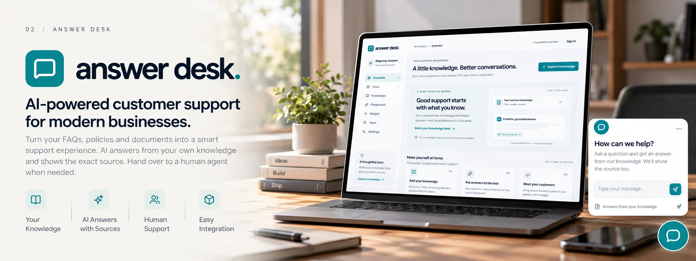

  <a href="https://ataullah.vercel.app/">Portfolio ↗</a> &nbsp; / &nbsp;
  <a href="https://github.com/ataullah1?tab=repositories">Projects</a> &nbsp; / &nbsp;
  <a href="https://linkedin.com/in/md-ataullah">LinkedIn</a> &nbsp; / &nbsp;
  <a href="mailto:dev.ataullah@gmail.com">Say hello ↗</a>

### A little context

I'm **Md Ataullah**, a Full-Stack Developer and SaaS Builder from Bangladesh. I enjoy building thoughtful digital products, modern interfaces, and software that solves real-world problems.

I recently completed and launched **[Review Room](https://rreviewroom.vercel.app/)**. Now I'm building **[Answer Desk](https://answerdeskk.vercel.app/)**, an AI customer support platform, with a focus on full-stack engineering, product architecture, UI/UX, and scalable applications.

 

## Selected Work ↘

### Answer Desk &nbsp; · &nbsp; In Development · Current Focus

An AI customer support platform that turns **FAQs, policies, and PDFs into answers with sources**, with human handoff when needed. Knowledge publishing, private visitor chat, an AI playground, and a human inbox are implemented, with role-based access for owners, admins, and agents.

`Next.js` `Better Auth` `Supabase` `Prisma` `Gemini` `Inngest`

Public chat is disabled pending AI quality evaluation. Next up: an embeddable website chat widget.

**[Explore Answer Desk ↗](https://answerdeskk.vercel.app/)** &nbsp; · &nbsp; **[Source code ↗](https://github.com/ataullah1/answer-desk)**

 

### Other Projects

**[Form Studio ↗](https://formstudioo.vercel.app/)** — A modern studio desk concept and customizable workspace presentation. 
**[Review Room ↗](https://rreviewroom.vercel.app/)** — Launched visual feedback and client approval platform. 
**[Role-Based OAuth Dashboard ↗](https://github.com/ataullah1/Role-Based-OAuth-Dashboard)** — Authentication and role-based dashboard patterns. 
**[Horizontal Collapse ↗](https://github.com/ataullah1/Horizontal-Collapse-Nextjs)** — An animated, reusable React / Next.js interface component.

[Browse the rest of my repositories ↗](https://github.com/ataullah1?tab=repositories)

 

## My everyday toolkit

| Layer | Tools |
| :--- | :--- |
| **Interface** | TypeScript · JavaScript · React · Next.js · Tailwind CSS |
| **Server & data** | Node.js · Express · PostgreSQL · Prisma · MongoDB |
| **Build & ship** | Supabase · Firebase · Git · Vercel · Figma |

 

---

### Have something in mind? Let's build it.

I'm open to freelance collaborations, remote opportunities, and interesting product ideas.

**[dev.ataullah@gmail.com ↗](mailto:dev.ataullah@gmail.com)** &nbsp; · &nbsp; [Portfolio](https://ataullah.vercel.app/) &nbsp; · &nbsp; [LinkedIn](https://linkedin.com/in/md-ataullah)

Based in Bangladesh. Building for the web.
