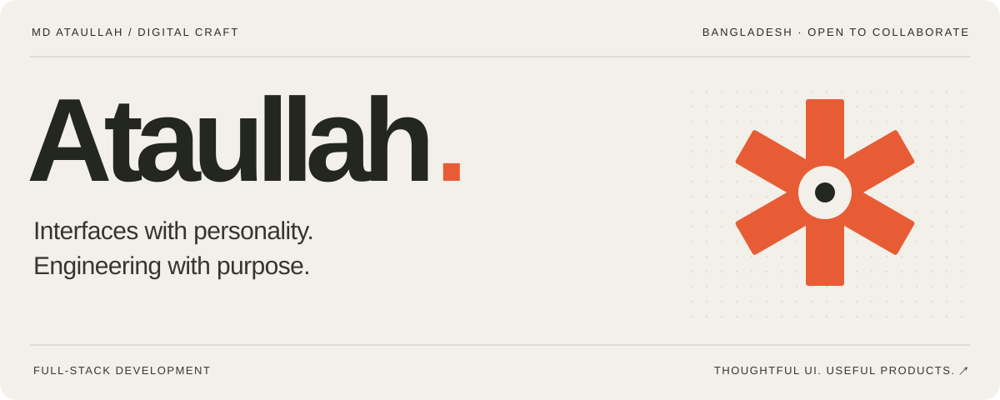
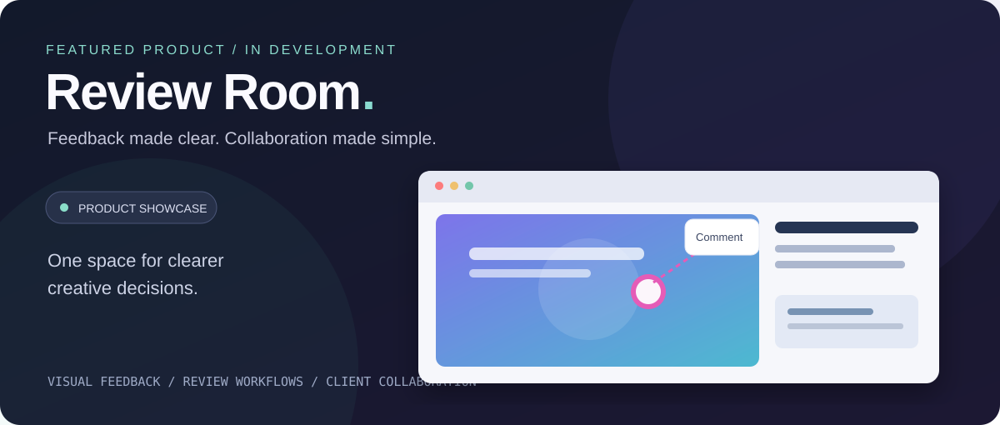

  <a href="https://ataullah.vercel.app/">Portfolio ↗</a> &nbsp; / &nbsp;
  <a href="https://github.com/ataullah1?tab=repositories">Projects</a> &nbsp; / &nbsp;
  <a href="https://linkedin.com/in/md-ataullah">LinkedIn</a> &nbsp; / &nbsp;
  <a href="mailto:dev.ataullah@gmail.com">Say hello ↗</a>

### A little context

I'm **Md Ataullah**, a developer from Bangladesh. I build for the web, from the first interface sketch to the logic behind it. I care about the small details: clear layouts, useful interactions, and software that makes someone's day a little easier.

Right now, I'm building **[Review Room](https://rreviewroom.vercel.app/)** and going deeper into SaaS architecture, databases, and application security.

 

## Things I'm building ↘

### Review Room &nbsp; · &nbsp; In development

Creative work comes with feedback. I'm building a place to keep **comments, revisions, and approvals** together, so creators, teams, and clients can move work forward with more clarity.

`Next.js` `TypeScript` `PostgreSQL` `Supabase` `Tailwind CSS`

**[Take a look at the live build ↗](https://rreviewroom.vercel.app/)**

 

| Also on my workbench | What it's about |
| :--- | :--- |
| **[Role-Based OAuth Dashboard ↗](https://github.com/ataullah1/Role-Based-OAuth-Dashboard)** | Exploring authentication and role-based dashboard patterns. |
| **[Horizontal Collapse ↗](https://github.com/ataullah1/Horizontal-Collapse-Nextjs)** | An animated, reusable interface component for React and Next.js. |

[Browse the rest of my repositories ↗](https://github.com/ataullah1?tab=repositories)

 

## My everyday toolkit

| Layer | Tools |
| :--- | :--- |
| **Interface** | TypeScript · JavaScript · React · Next.js · Tailwind CSS |
| **Server & data** | Node.js · Express · PostgreSQL · Prisma · MongoDB |
| **Build & ship** | Supabase · Firebase · Git · Vercel · Figma |

 

---

### Have something in mind? Let's build it.

I'm open to freelance collaborations, remote opportunities, and interesting product ideas.

**[dev.ataullah@gmail.com ↗](mailto:dev.ataullah@gmail.com)** &nbsp; · &nbsp; [Portfolio](https://ataullah.vercel.app/) &nbsp; · &nbsp; [LinkedIn](https://linkedin.com/in/md-ataullah)

Based in Bangladesh. Building for the web.
